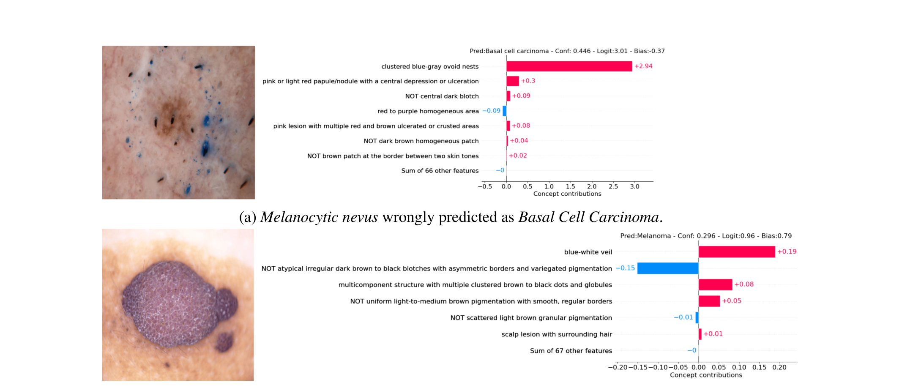
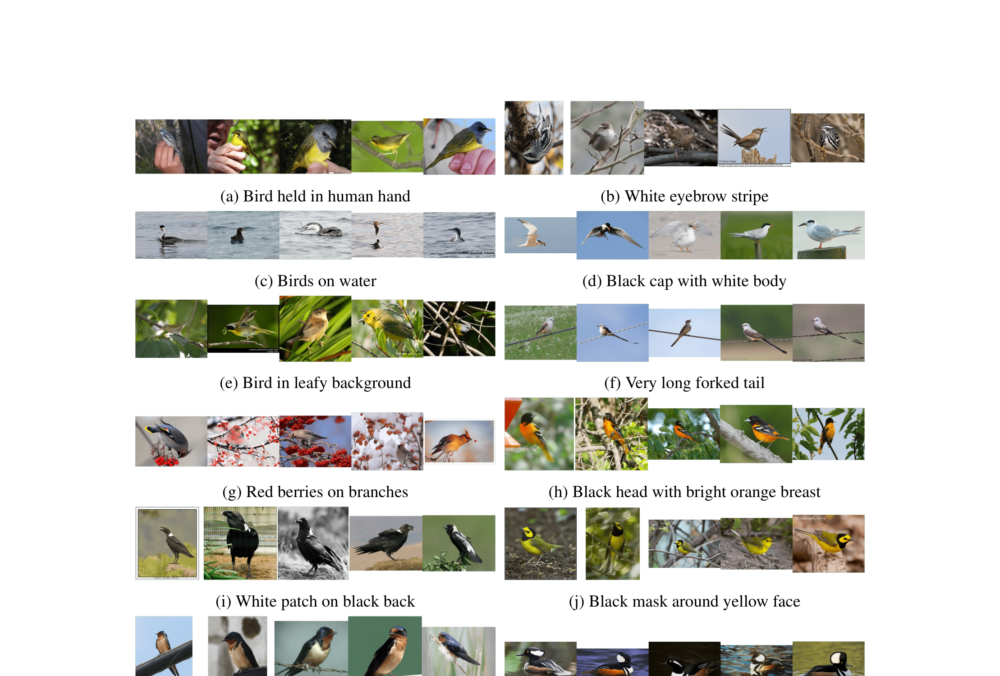

<!-- _class: title -->
<!-- _paginate: false -->
<!-- _footer: "Kamil Rudny, Szymon Szarek, Mateusz Grzybek Akademia Górniczo-Hutnicza w Krakowie" -->

# Czy możemy odkryć, czego nauczyła się sieć neuronowa?

*Learning Concept Bottleneck Models from Mechanistic Explanations*
ICLR 2026 (Antonio De Santis et al., MIT CSAIL & Polimi)

<!--
Notatki:
- Wprowadzenie tematu: interpretowalność mechaniczna sieci (ICLR 2026, MIT & Polimi)
- Cel: odkrywanie ludzkich pojęć wewnątrz modeli wizyjnych
- Plan: 1. Omówienie artykułu (M-CBM), 2. Nasz plan laboratoryjny
-->

---
<!-- 1 -->
# Problem: sieć neuronowa nie wyjaśnia swoich decyzji

Sieć neuronowa rozpoznaje gatunek ptaka na zdjęciu z dużą dokładnością, ale nie potrafi wyjaśnić, dlaczego wybrała właśnie ten gatunek.

Decyzja wynika z milionów parametrów sieci, a pojedynczy neuron często reaguje na kilka niepowiązanych ze sobą wzorców naraz.

Z zewnątrz widzimy tylko wynik. Nie wiemy, czy sieć patrzy na ptaka, czy na przypadkowy szczegół, na przykład tło zdjęcia.

  
WejścieZdjęcie ptaka

  
→

  
Sieć neuronowaMiliony parametrów w ukrytych warstwach

  
→

  
WyjścieHooded Warbler

  
→

  
ProblemBrak odpowiedzi, skąd wziął się wynik

---

<!-- 2 -->
# Dlaczego wyjaśnialność ma znaczenie

**Zaufanie w zastosowaniach krytycznych.** W opiece zdrowotnej, autonomicznych samochodach czy obronności model musi być przejrzysty, nie tylko dokładny.

**Wykrywanie fałszywych korelacji.** Sieć może dać poprawny wynik z niewłaściwego powodu — np. rozpoznając ptaka po tle zamiast po nim samym.

**Poprawianie błędów.** Wyzerowanie jednej zawodnej cechy potrafi zmienić błędną diagnozę na poprawną.

**Odpowiedzialność za decyzję.** Lekarz korzystający z wyniku musi umieć go uzasadnić pacjentowi.

---
<!-- skrócone: każdy z 4 punktów zmieścił się w jednym zdaniu zamiast dwóch - usunięte: "Artykuł wymienia" (zbędne odwołanie do źródła), "Bez wyjaśnienia nikt tego nie zauważy" (domyślne z kontekstu), "W artykule" + powtórzone podsumowanie w pkt. 3, uogólnienie "Osoba korzystająca z wyniku" zastąpione konkretem "Lekarz" -->
<!-- skrócone, brak możliwości przypisania pojedynczej cechy neuronowi opisany później -->

<!-- 3 -->
# Dwa sposoby wyjaśniania decyzji sieci

Metody wyjaśniania dzielą się na dwie grupy, zależnie od tego, czy wyjaśniamy gotową sieć, czy budujemy sieć, która wyjaśnia się sama.

  
Wyjaśnianie decyzji sieci neuronowej

  

    

      
↓

      
Post-hocPo fakcie

    

    

      
↓

      
Ante-hocZ założenia

    

  

---

<!-- 4 -->
# Post-hoc, czyli wyjaśnianie po fakcie

**Jak działa?** Sieć jest już wytrenowana i zostaje bez zmian. Mapa atrybucji (ang. Saliency) sprawdza, jak zmiana pikseli wpływa na wynik wybranej klasy, i zaznacza je na zdjęciu jako mapę ciepła.

**Co daje?** Pokazuje, które obszary zdjęcia najmocniej podniosły wynik klasy — czyli na co sieć zwróciła największą uwagę.

**Ograniczenie.** Mapa nie mówi, czy zaznaczony obszar oznacza dziób, kolor czy teksturę. Nie wiemy, jakie pojęcie sieć rozpoznała.

  
WejścieZdjęcie ptaka

  
→

  
SiećWytrenowana, bez zmian

  
→

  
WyjścieHooded Warbler

  
→

  
WyjaśnienieMapa ciepła na pikselach

---

<!-- 5 -->
# Ante-hoc, czyli CBM z nazwanych pojęć

**Jak działa?** CBM dzieli model na dwie części: warstwę pojęć (ang. Concept Bottleneck Layer), która przewiduje z obrazu, które z nazwanych pojęć występują, oraz rzadki klasyfikator liniowy, który wybiera klasę wyłącznie na ich podstawie. Cała informacja o obrazie musi przejść przez to wąskie gardło, czyli listę pojęć.

**Co daje?** Decyzję można odczytać wprost, bo wkład pojęcia w klasę to jego wartość pomnożona przez wagę.

  
WejścieZdjęcie ptaka

  
→

  
Warstwa pojęćżółty ptak z czarną maską wokół oczu czarna maska wokół żółtej twarzy oliwkowozielony grzbiet

  
→

  
Klasyfikator liniowyWybór klasy z pojęć

  
→

  
WyjścieHooded Warbler

---

<!-- _class: two-columns -->
<!-- 6 -->
# Co jest nie tak z CBM?

## Problem 1. Pojęcia wybrane z góry

Dotychczasowe metody biorą pojęcia od ekspertów, z grafów wiedzy (baz powiązanych pojęć) albo z odpowiedzi dużych modeli językowych (LLM). Takie pojęcia mogą nie pomagać w rozpoznaniu klasy albo nie dać się nauczyć z obrazów. Dla zbioru zmian skórnych LLM zaproponował pojęcia "warm to the touch" i "medical report", których nie widać na zdjęciu.

## Problem 2. Wyciek informacji

Wyciek oznacza, że CBM jest dokładny dzięki ukrytym wzorcom w wartościach pojęć, a nie dzięki ich znaczeniu — np. pojęcie oznaczone tylko na obrazach jednej klasy działa jak jej etykieta. VLG-CBM, z losowymi frazami typu "bird pizza" zamiast nazw pojęć, dorównuje dokładnością oryginalnej sieci przy średnio około 1,5 pojęcia na decyzję. Model wygląda na czytelny, ale w praktyce dalej jest czarną skrzynką.

---

<!-- 7 -->
# Pomysł autorów, czyli Mechanistic CBM (M-CBM)

Zamiast wybierać pojęcia z góry, autorzy biorą te, których wytrenowana sieć już używa. Spodziewają się, że łatwiej je nauczyć i że lepiej przewidują klasę.

Metoda ma cztery kroki.

  
Krok 1Autoenkoder rzadki (SAE) rozkłada reprezentację na kandydatów na pojęcia

  
→

  
Krok 2Model GPT-4.1 nazywa każdy neuron na podstawie zdjęć

  
→

  
Krok 3GPT-4.1 oznacza zdjęcia treningowe

  
→

  
Krok 4Trening warstwy pojęć i klasyfikatora
 <!-- Skróciłem te punkty, bo te wpisy są dokładniej rozwinięte na następnych slajdach-->

---

<!-- 8 -->
# Krok 1. Wydobycie pojęć z sieci

Każde zdjęcie treningowe przechodzi przez wytrenowaną sieć (ResNet-18), która zamienia je na wektor 512 liczb. Pojedyncza liczba nie odpowiada jednej cesze, bo cechy w wektorze są pomieszane.

Autoenkoder rzadki (SAE) rozkłada ten wektor na proste składniki, ucząc się jednocześnie go odtwarzać i aktywować dla jednego zdjęcia tylko kilka neuronów — każdy taki neuron to kandydat na pojęcie.

<!-- Na zbiorze CUB SAE ma 512 neuronów, a dla jednego zdjęcia włącza się średnio 7,66 z nich. Neurony, które nie włączają się nigdy lub prawie nigdy, autorzy usuwają, o ile jakość spada najwyżej o około 1%.  usunięte - Powtórzenie treści z diagramu--> 

  
WejścieZdjęcie ptaka (zbiór CUB-200)

  
→

  
SiećWektor 512 liczb

  
→

  
SAERozkład na neurony

  
→

  
WynikWłączone średnio 7,66 z 512 neuronów

 
<small>SAE - Sparse Autoencoder - Autoenkoder rzadki</small>

---

<!-- 9 -->
# Krok 2. Nazwanie pojęć

Dla każdego neuronu SAE autorzy wybierają 10 zdjęć, które włączają go najmocniej, i nakładają na nie mapy ciepła. Dodają też 10 zdjęć nieaktywnych — połowę losowych, połowę podobnych do aktywnych, by wymusić wskazanie drobnej cechy przez model.

GPT-4.1 dostaje te zdjęcia i pytanie "What is this neuron looking for?". Odpowiada krótką nazwą, na przykład "black mask around yellow face". Nie może użyć nazwy klasy. Jeśli to zrobi, pytanie jest ponawiane.

Na końcu autorzy łączą nazwy o podobieństwie powyżej 0,98 w jedno pojęcie. Zostaje 278 pojęć dla CUB, 73 dla ISIC2018 i 2648 dla ImageNet. Nazwanie jednego pojęcia kosztuje około 0,02 USD.

  
Neuron SAEKandydat na pojęcie

  
→

  
Zdjęcia10 aktywnych i 10 nieaktywnych

  
→

  
GPT-4.1Co szuka ten neuron?

  
→

  
WynikKrótka nazwa pojęcia

---

<!-- 10 -->
# Krok 3. Oznaczenie zdjęć

Nazwa neuronu to tylko hipoteza o tym, na co on reaguje. Dlatego autorzy nie używają neuronów SAE wprost jako pojęć. GPT-4.1 oznacza zdjęcia treningowe, a nowa warstwa pojęć uczy się na tych etykietach.

Połowa zdjęć wybieranych dla każdego pojęcia mocno włącza neuron (powyżej 95. percentyla aktywacji), a połowa to zdjęcia nieaktywne. Obie grupy obejmują równomiernie wszystkie klasy, żeby pojęcie nie związało się z jedną klasą.

Siatka jest tańsza, ale mniej dokładna. Na CUB trafność oznaczeń wynosi 69,46% przy siatce i 74,00% przy etykietowaniu pojedynczych zdjęć, co wymaga jednak 25 razy więcej zapytań.

  
1000zdjęć na jedno pojęcie

  
5 × 525 zdjęć w jednym zapytaniu do GPT-4.1

  
1 / 0 / -1jest, brak, brak etykiety

---

<!-- 11 -->
# Krok 4. Trening modelu z wąskim gardłem

Model ma trzy części. Zamrożona sieć zamienia zdjęcie na wektor liczb. Warstwa pojęć (CBL) przewiduje z niego, czy występuje każde pojęcie, i uczy się na etykietach z kroku 3, pomijając pary bez etykiety. Rzadki klasyfikator liniowy wybiera klasę wyłącznie na podstawie wartości pojęć.

Kara w klasyfikatorze zeruje większość wag, więc każda klasa zależy od kilku pojęć. Wkład pojęcia w decyzję to jego wartość pomnożona przez wagę. Poniżej wkłady dla Hooded Warbler.

  
żółty ptak z czarną maską wokół oczu+4,80

  
czarna maska wokół żółtej twarzy+4,34

  
jaskrawożółte upierzenie z czarną czapką+1,28

  
żółty wierzch, ciemne ciało i dziób+0,38

  
oliwkowozielony grzbiet+0,12

  
pozostałe 273 pojęcia razem+0,05

---

<!-- 12 -->
# NCC, czyli uczciwe porównanie modeli

Im więcej pojęć klasyfikator może użyć, tym wyższą ma dokładność, ale rośnie też wyciek, a wyjaśnienia robią się długie. Modele trzeba więc porównywać przy takiej samej liczbie pojęć w decyzji.

Wcześniejsza miara NEC (Number of Effective Concepts), licząca średnią liczbę niezerowych wag na klasę, przy małej liczbie klas ogranicza cały słownik pojęć — np. przy 3 klasach i NEC=5 model może mieć najwyżej 15 pojęć.

NCC (Number of Contributing Concepts) liczy dla każdej decyzji, ile pojęć pokrywa 95% sumy wkładów, i uśrednia wynik. NCC=5 oznacza, że średnio 5 pojęć tłumaczy co najmniej 95% decyzji. Model może mieć wiele pojęć, ale pojedynczą decyzję tłumaczy kilkoma.

---

<!-- 13 -->
# Wyniki i ograniczenia metody M-CBM

- **Trafność CUB-200** ($NCC=5$): **76.7%** (Black-Box) vs **73.7%** (**M-CBM**) vs **69.1%** (VLG-CBM).
- **Interwencja**: modyfikacja pojedynczej cechy odwraca błędną diagnozę czerniaka (ISIC 2018).

- **Ograniczenia**: koszt i czas zapytań API VLM (ang. Vision-Language Model, ~0.16$ / cechę), wyzwanie przy tysiącach pojęć.

<!--
Notatki:
- Wyniki na ptakach (CUB-200): M-CBM (73.7%) deklasuje VLG-CBM (69.1%) i goni Black-Box (76.7%)
- Interwencja: zmiana 1 cechy koryguje błędną diagnozę czerniaka (ISIC)
- Ograniczenia: koszt i czas API modeli VLM (~0.16$/cechę)
-->

---

<!-- 14 -->
# Co chcemy sprawdzić w projekcie?

Pytanie 1
<h3>Czytelność cech</h3>

Czy cechy wyuczone przez SAE odpowiadają spójnym pojęciom wizualnym (inspekcja Top-K aktywacji)?

Pytanie 2
<h3>Porównanie metod</h3>

Która metoda daje najczytelniejszą reprezentację: <b>PCA</b> (analiza głównych składowych), gęsty <b>Autoenkoder</b> czy <b>SAE</b>?

Pytanie 3
<h3>Wpływ ablacji</h3>

Czy wyzerowanie danej cechy (interwencja) w przewidywalny sposób zmienia decyzję klasyfikatora?

<!--
Notatki:
- Pytanie 1: inspekcja wizualna - czy cechy z SAE są czytelne dla oka ludzkiego?
- Pytanie 2: porównanie metod redukcji - PCA vs gęsty Autoenkoder vs rzadki SAE
- Pytanie 3: interwencja / ablacja - czy wyzerowanie cechy logicznie zmienia wynik?
-->

---

# Wybór zbioru danych

| Zbiór | Klasy | Dane | Interpretowalność cech |
|---|---|---|---|
| **CUB-200-2011** | 200 (gatunki ptaków) | ~11 800 zdjęć, wysoka rozdzielczość | Wysoka — wyraziste cechy wizualne (dziób, upierzenie, skrzydła) |
| ISIC 2018 | 7 (zmiany skórne) | ~10 000 zdjęć dermatoskopowych | Niska dla laika — cechy wymagają wiedzy medycznej |
| CIFAR-10 | 10 (obiekty ogólne) | 60 000 zdjęć, 32×32 px | Niska — zbyt mała rozdzielczość na analizę szczegółów |

Wybieramy **CUB-200-2011** — wyraziste, nazywalne cechy wizualne oraz bezpośrednia porównywalność z wynikami z artykułu (ten sam zbiór w M-CBM).

<!--
Notatki:
- Trzy kandydatury wprost z treści zadania projektowego
- CIFAR-10 odpada przez rozdzielczość 32x32 - za mało szczegółu na cechy wizualne
- ISIC2018 odpada bo cechy medyczne trudno ocenić bez wiedzy eksperckiej
- CUB-200-2011 wygrywa też dlatego, że to ten sam zbiór co w artykule - łatwiej porównać wyniki
-->

---

# Plan realizacji w trzech poziomach

Poziom 1: MVP
<h3>Minimum</h3>
<ul>
  <li>Trening ResNet-18 i ekstrakcja cech.</li>
  <li>Trening Sparse Autoencodera (SAE).</li>
  <li>Wizualizacja Top-K aktywacji dla cech.</li>
</ul>

Poziom 2: Standard
<h3>Wersja właściwa</h3>
<ul>
  <li>Porównanie: <b>PCA vs AE vs SAE</b>.</li>
  <li>Ocena rzadkości i błędu rekonstrukcji.</li>
  <li>Testy ablacji (wyłączanie cech).</li>
</ul>

Poziom 3: Ambitny
<h3>Wersja rozszerzona</h3>
<ul>
  <li>Etykietowanie cech modelem VLM.</li>
  <li>Rzadki klasyfikator liniowy na cechach.</li>
  <li>Weryfikacja wycieku informacji (*leakage*).</li>
</ul>

<!--
Notatki:
- Poziom 1 (MVP): pipeline bazowy (ResNet-18 + SAE + skrypt wizualizacji Top-K)
- Poziom 2 (Właściwy): porównanie jakości reprezentacji (PCA vs AE vs SAE) + ablacja
- Poziom 3 (Ambitny): automatyczne nazwy z VLM + klasyfikator + test leakage
-->

---

# Słownik pojęć

<h3>ResNet</h3>

Konwolucyjna sieć neuronowa z połączeniami rezydualnymi (ang. residual connections), które ułatwiają trening głębokich warstw.

<h3>PCA</h3>

Analiza głównych składowych — klasyczna metoda redukcji wymiarowości. Znajduje kierunki o największej wariancji w danych i rzutuje na nie wektor cech, bez wymuszania rzadkości czy interpretowalności pojedynczych komponentów.

<h3>AE</h3>

Gęsty autoenkoder — sieć ucząca się kompresować i odtwarzać wektor cech, bez ograniczeń na rzadkość aktywacji. W przeciwieństwie do SAE aktywne są zwykle wszystkie neurony warstwy ukrytej, co utrudnia przypisanie im pojedynczych, nazwalnych pojęć.

<h3>Top-K</h3>

Dla danej cechy (neuronu) wybieramy K zdjęć, które najmocniej ją aktywują. Sprawdzając te zdjęcia oceniamy, czy cecha odpowiada spójnemu pojęciu wizualnemu, np. zawsze temu samemu kolorowi upierzenia czy kształtowi dzioba.

<h3>VLM</h3>

Vision-Language Model — model łączący rozumienie obrazu z językiem naturalnym (np. GPT-4.1), opisujący słowami to, co widzi na zdjęciu.

<!--
Notatki:
- Krótki słownik pojęć przed wejściem w szczegóły Kroków A-D
- ResNet to nasz klasyfikator bazowy (Krok A), Top-K to metoda inspekcji cech (Pytanie 1, Krok C)
- PCA i AE będą porównywane z SAE w Kroku C
- VLM dotyczy poziomu ambitnego (automatyczne nazywanie cech)
-->

---

<!-- _class: two-columns -->

# Krok A. Klasyfikator bazowy i ekstrakcja cech

Trenujemy ResNet-18 na CUB-200-2011 jako nasz "czarnoskrzynkowy" klasyfikator bazowy — analogicznie do modelu z artykułu.

Z warstwy `avgpool`, czyli ostatniej przed klasyfikatorem, wyciągamy dla każdego zdjęcia wektor 512 liczb. To reprezentacja, którą w Kroku B rozłoży autoenkoder.

**Środowisko**: PyTorch, trening na GPU.

<!--
Notatki:
- ResNet-18 trenowany na CUB-200-2011, tak samo jak backbone w artykule
- Embeddingi z warstwy avgpool (512 liczb na zdjęcie)
- To wejście do Kroku B (SAE)
-->

---

# Krok B. Trening Sparse Autoencodera

Na zamrożonych embeddingach z Kroku A trenujemy Sparse Autoencoder (SAE). Uczy się on rekonstruować wektor 512 liczb, aktywując przy tym tylko kilka neuronów na zdjęcie — każdy aktywny neuron to kandydat na pojęcie.

Jakość oceniamy dwoma miarami: błędem rekonstrukcji (MSE) oraz stopniem rzadkości aktywacji (ile neuronów włącza się średnio na zdjęcie).

  
WejścieWektor 512 liczb (Krok A)

  
→

  
SAERekonstrukcja + rzadka aktywacja

  
→

  
WynikKandydaci na pojęcia

<!--
Notatki:
- SAE trenowany na zamrożonych embeddingach z Kroku A
- Dwa cele: rekonstrukcja wektora + rzadka aktywacja
- Ewaluacja: MSE rekonstrukcji i rzadkość (średnia liczba aktywnych neuronów)
-->

---

# Krok C. Interpretowalność i porównanie metod

Dla każdej cechy SAE wybieramy obrazy najmocniej ją aktywujące (Top-K) i sprawdzamy, czy odpowiadają spójnemu pojęciu wizualnemu — np. zawsze temu samemu kształtowi dzioba czy kolorowi upierzenia.

Tę samą analizę powtarzamy dla PCA i klasycznego, gęstego autoenkodera, żeby ocenić, która reprezentacja daje najbardziej czytelne, monosemantyczne cechy.

  
PCAKomponenty główne

  
↔

  
Gęsty AEAutoenkoder bez rzadkości

  
↔

  
SAEAutoenkoder rzadki

<!--
Notatki:
- Inspekcja Top-K obrazów per cecha - czy cecha jest spójna wizualnie
- Porównanie trzech metod redukcji: PCA, gęsty AE, SAE
- Cel: sprawdzić, która reprezentacja jest najbardziej monosemantyczna
-->

---

# Krok D. Interwencja na cechach

Wyzerowujemy wybraną cechę i sprawdzamy, jak zmienia się predykcja oraz pewność klasyfikatora.

Jeśli wyłączenie cechy w przewidywalny sposób zmienia decyzję, to dowód, że cecha faktycznie odpowiada za rozpoznawany wzorzec wizualny, a nie jest przypadkowa.

  
PrzedCecha aktywna → predykcja X

  
→

  
AblacjaZerowanie cechy

  
→

  
PoPredykcja i pewność — zmiana?

<!--
Notatki:
- Ablacja = wyzerowanie wybranej cechy przed klasyfikatorem
- Mierzymy zmianę predykcji i pewności (confidence)
- Przewidywalna zmiana = dowód, że cecha realnie coś reprezentuje
-->

---

# Jak ocenimy wyniki? (Ewaluacja)

| Wymiar ewaluacji | Metoda / Metryka | Cel weryfikacji |
|---|---|---|
| **Interpretowalność** | Inspekcja Top-K obrazów | Spójność wizualna aktywacji cechy |
| **Monosemantyczność** | Porównanie PCA, AE i SAE | Skuteczność rozplątania superpozycji |
| **Wierność rekonstrukcji** | Błąd MSE + Spadek Accuracy | Zachowanie wiedzy modelu ResNet-18 |
| **Ablacja (Interwencja)** | Zmiana predykcji klasyfikatora | Wpływ wyłączenia cechy na pewność decyzji |

<!--
Notatki:
- Jakościowa: inspekcja wzrokowa Top-K (czy cecha reaguje zawsze na ten sam detal)
- Porównawcza: monosemantyczność w SAE vs gęsty autoenkoder i PCA
- Błąd rekonstrukcji: MSE i wpływ kompresji na accuracy klasyfikatora
- Ablacja: pomiar spadku pewności modelu po wyzerowaniu kluczowej cechy
-->

---

# Literatura

<h3>Scaling and evaluating sparse autoencoders</h3>

<a href="https://proceedings.iclr.cc/paper_files/paper/2025/hash/42ef3308c230942d223c411adf182c88-Abstract-Conference.html">ICLR 2025</a>

Analiza, jak jakość i rzadkość cech SAE skaluje się wraz z rozmiarem modelu i danych; wprowadza aktywację TopK jako alternatywę dla kary L1.

<h3>A Holistic Approach to Unifying Automatic Concept Extraction and Concept Importance Estimation</h3>

<a href="https://proceedings.neurips.cc/paper_files/paper/2023/hash/abf3682c9cf9245a0294a4bebe4544ff-Abstract-Conference.html">NeurIPS 2023</a>

Łączy automatyczne wydobywanie pojęć wizualnych z oceną ich wpływu na decyzję klasyfikatora w jedną spójną metodę.

<h3>Sparse Autoencoders Learn Monosemantic Features in Vision-Language Models</h3>

<a href="https://proceedings.neurips.cc/paper_files/paper/2025/hash/89e83382abeee53b932a6df62edbf9cc-Abstract-Conference.html">NeurIPS 2025</a>

Pokazuje, że SAE trenowane na reprezentacjach modeli wizyjno-językowych odkrywają cechy monosemantyczne, podobnie jak w modelach językowych.

---

# Literatura (c.d.)

<h3>Interpretable and Testable Vision Features via Sparse Autoencoders</h3>

<a href="https://arxiv.org/abs/2502.06755">arXiv, 2025</a>

Trenuje SAE na reprezentacjach modeli wizyjnych i proponuje sposób testowania, czy odkryte cechy faktycznie odpowiadają spójnym pojęciom.

<h3>Deep Residual Learning for Image Recognition</h3>

<a href="https://openaccess.thecvf.com/content_cvpr_2016/html/He_Deep_Residual_Learning_CVPR_2016_paper.html">CVPR 2016</a>

Oryginalna praca wprowadzająca architekturę ResNet, którą trenujemy i analizujemy w naszym projekcie.

