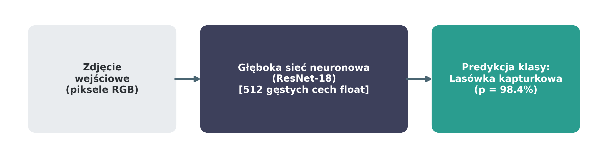
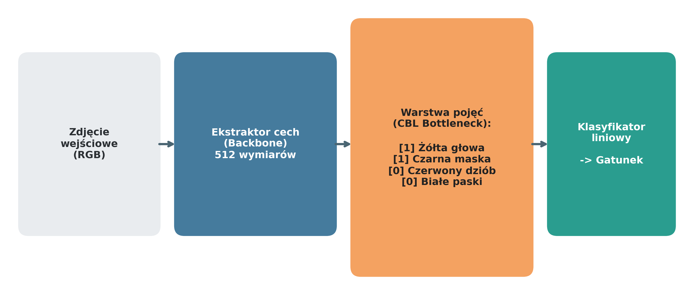
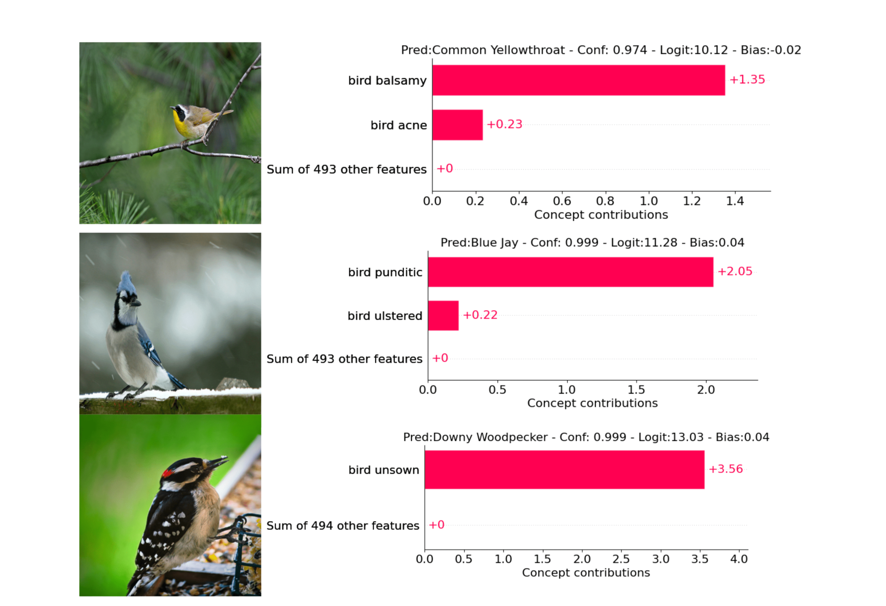
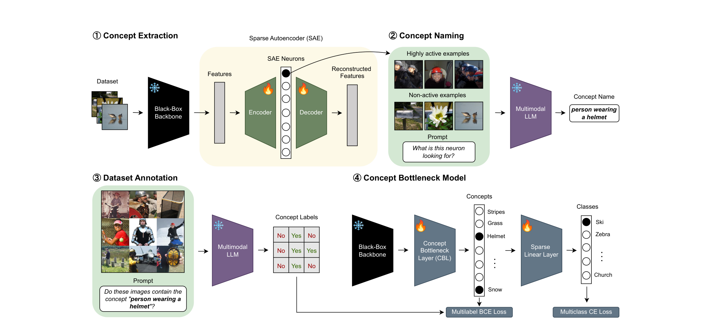
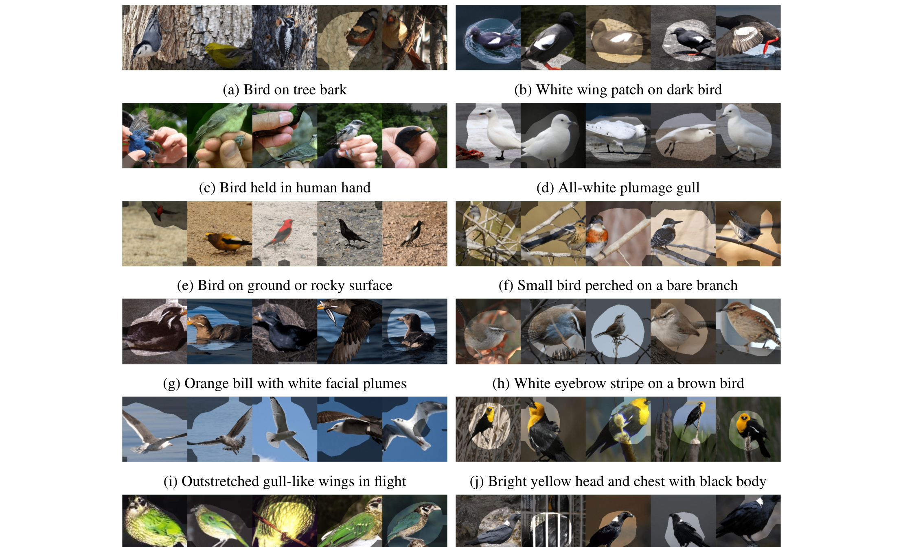
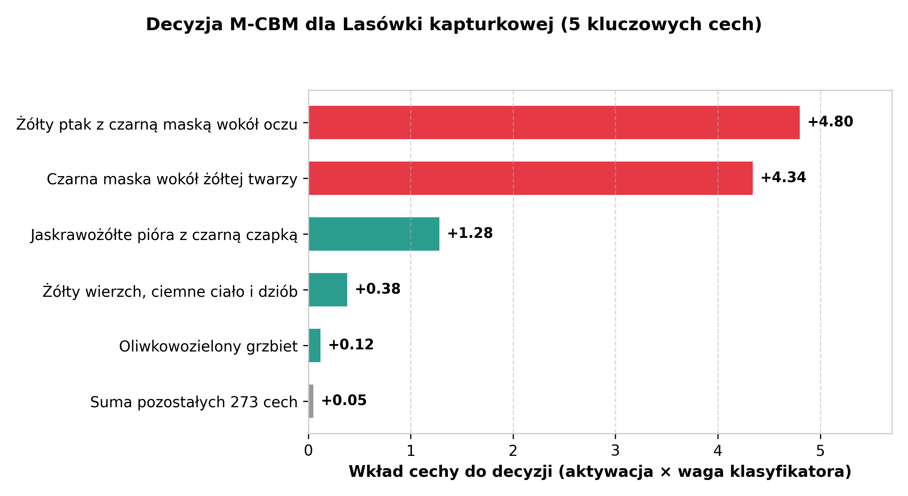

<!-- _class: title -->
<!-- _paginate: false -->
<!-- _footer: "Kamil Rudny, Szymon Szarek, Mateusz Grzybek Akademia Górniczo-Hutnicza w Krakowie" -->

# Czy możemy odkryć, czego nauczyła się sieć neuronowa?

*Learning Concept Bottleneck Models from Mechanistic Explanations*
ICLR 2026 (Antonio De Santis et al., MIT CSAIL & Polimi)

<!--
Notatki:
- Wprowadzenie tematu: interpretowalność mechaniczna sieci (ICLR 2026, MIT & Polimi)
- Cel: odkrywanie ludzkich pojęć wewnątrz modeli wizyjnych
- Plan: 1. Omówienie artykułu (M-CBM), 2. Nasz plan laboratoryjny
-->

---

# Problem: Czarna skrzynka w głębokim uczeniu

- Modele osiągają wysoką trafność, lecz ich proces decyzyjny jest niejawny (*Black-Box*).
- Tradycyjne mapy atrybucji (Saliency) wskazują jedynie *piksele*, a nie *pojęcia semantyczne*.

<!--
Notatki:
- Black-Box: wejście piksele -> 512 ukrytych floatów -> predykcja (brak "dlaczego?")
- Zastosowania krytyczne: medycyna, diagnostyka, finanse
- Saliency maps / Grad-CAM: podświetlają piksele, a nie pojęcia (dziób, skrzydło, tło)
-->

---

# Wcześniejsze rozwiązanie: Concept Bottleneck Models (CBM)

- **Wyjaśnialność *ante-hoc***: wymuszenie warstwy pojęć pośrednich ($Obraz \to Pojęcia \to Klasa$).
- **Klasyfikator liniowy** podejmuje decyzję wyłącznie na podstawie obecności jawnych cech.

<!--
Notatki:
- Idea CBM: wymuszona warstwa pośrednia z pojęciami (żółta głowa, czarna maska)
- Wyjaśnialność ante-hoc: klasyfikator liniowy decyduje wyłącznie z cech
- Podejście klasyczne: cechy narzucane z góry (ekspert, LLM, CLIP)
-->

---

<!-- _class: two-columns -->

# Co jest nie tak z tradycyjnym CBM?

- **Pojęcia *a priori* nie pasują do danych**:
  Cechy wymyślone z góry bywają trudne do wyuczenia lub pomijają kluczowe sygnały.
- **Wyciek informacji (*Information Leakage*)**:
  Model koduje klasy pod etykietami cech.
- **Eksperyment kontrolny**:
  Zastąpienie cech **losowymi słowami** (*„bird balsamy”*) daje niemal identyczny wynik!

<!--
Notatki:
- Problem 1: ludzkie cechy a priori nie pasują do tego, co sieć widzi w pikselach
- Problem 2: wyciek informacji (leakage) - sieć oszukuje przy szerokiej warstwie
- Rycina z artykułu: losowe słowa ("bird balsamy", "bird punditic") dają wysoką dokładność
-->

---

# Pomysł autorów: Mechanistic CBM (M-CBM)

- Odkrywanie cech **bezpośrednio z wnętrza sieci** zamiast ich arbitralnego narzucania z góry.
- Zastosowanie **Sparse Autoencoders (SAE)** do dekompozycji cech oraz modeli **VLM** do ich nazywania.

<!--
Notatki:
- Zmiana paradygmatu: wyciągamy cechy z wnętrza wytrenowanej sieci zamiast zgadywać
- Sparse Autoencoder (SAE) rozplątuje wektory, model VLM je nazywa
- 4 kroki: 1. Backbone -> 2. SAE -> 3. Nazywanie VLM -> 4. Rzadki klasyfikator
-->

---

<!-- _class: two-columns -->

# Kroki 1 i 2: Rozłożyć i nazwać

- **Krok 1: Sparse Autoencoder (SAE)**
  Rozbicie polisemantycznych neuronów sieci na rzadkie, **monosemantyczne** kierunki.
- **Krok 2: Nazywanie cech (VLM)**
  Wybór Top-10 aktywacji i wygenerowanie semantycznej etykiety przez model wizyjny (GPT-4.1).

<!--
Notatki:
- Superpozycja: pojedynczy neuron reaguje na kilka różnych rzeczy (polisemantyczność)
- SAE rzutuje w wyższy wymiar z wymuszeniem rzadkości -> cechy monosemantyczne
- VLM (GPT-4.1) dostaje Top-10 aktywacji i prompt kontrastowy -> precyzyjna etykieta
-->

---

<!-- _class: two-columns -->

# Kroki 3 i 4: Sprawdzić i zbudować model

- **Krok 3: Weryfikacja obecności cech**
  Model VLM potwierdza obecność cechy na podzbiorze ~1000 obrazów (paczkowanie $5 \times 5$).
- **Krok 4: Rzadki klasyfikator liniowy**
  Wymuszenie rzadkości (**NCC = 5**): decyzja modelu opiera się średnio na **5 kluczowych cechach**.

<!--
Notatki:
- Krok 3: potwierdzenie cechy na podzbiorze obrazów (siatka 5x5 oszczędza koszt API)
- Krok 4: rzadki klasyfikator liniowy łączący cechy z klasami
- Metryka NCC=5: średnio zaledwie 5 pojęć tłumaczy decyzję (wykres Lasówki)
-->

---

# Wyniki i ograniczenia papera

- **Trafność CUB-200** ($NCC=5$): **76.7%** (Black-Box) vs **73.7%** (**M-CBM**) vs **69.1%** (VLG-CBM).
- **Interwencja**: modyfikacja pojedynczej cechy odwraca błędną diagnozę czerniaka (ISIC 2018).
- **Ograniczenia**: koszt i czas zapytań API VLM (~0.16$ / cechę), wyzwanie przy tysiącach pojęć.

<!--
Notatki:
- Wyniki na ptakach (CUB-200): M-CBM (73.7%) deklasuje VLG-CBM (69.1%) i goni Black-Box (76.7%)
- Interwencja: zmiana 1 cechy koryguje błędną diagnozę czerniaka (ISIC)
- Ograniczenia: koszt i czas API modeli VLM (~0.16$/cechę)
-->

---

# Co chcemy sprawdzić w projekcie?

Pytanie 1
<h3>Czytelność cech</h3>

Czy cechy wyuczone przez SAE odpowiadają spójnym pojęciom wizualnym (inspekcja Top-K aktywacji)?

Pytanie 2
<h3>Porównanie metod</h3>

Która metoda daje najczytelniejszą reprezentację: <b>PCA</b>, gęsty <b>Autoenkoder</b> czy <b>SAE</b>?

Pytanie 3
<h3>Wpływ ablacji</h3>

Czy wyzerowanie danej cechy (interwencja) w przewidywalny sposób zmienia decyzję klasyfikatora?

<!--
Notatki:
- Pytanie 1: inspekcja wizualna - czy cechy z SAE są czytelne dla oka ludzkiego?
- Pytanie 2: porównanie metod redukcji - PCA vs gęsty Autoenkoder vs rzadki SAE
- Pytanie 3: interwencja / ablacja - czy wyzerowanie cechy logicznie zmienia wynik?
-->

---

<!-- _class: two-columns -->

# Dane i modele bazowe

- **Zbiór CUB-200-2011**:
  200 gatunków ptaków, wyraziste cechy wizualne (dziób, ubarwienie, skrzydła).
- **Model bazowy (Backbone)**:
  ResNet-18, ekstrakcja wektora 512 cech z warstwy `avgpool`.
- **Środowisko obliczeniowe**:
  PyTorch + biblioteka SAE, czas treningu SAE: **~10–20 min na GPU**.

<!--
Notatki:
- Zbiór: CUB-200-2011 (200 gatunków ptaków, bogate cechy anatomiczne)
- Backbone: ResNet-18, ekstrakcja 512 cech z warstwy avgpool
- Czas treningu: SAE na zamrożonych embeddingach uczy się szybko (~10-20 min na GPU)
-->

---

# Plan realizacji w trzech poziomach

Poziom 1: MVP
<h3>Minimum</h3>
<ul>
  <li>Trening ResNet-18 i ekstrakcja cech.</li>
  <li>Trening Sparse Autoencodera (SAE).</li>
  <li>Wizualizacja Top-K aktywacji dla cech.</li>
</ul>

Poziom 2: Standard
<h3>Wersja właściwa</h3>
<ul>
  <li>Porównanie: <b>PCA vs AE vs SAE</b>.</li>
  <li>Ocena rzadkości i błędu rekonstrukcji.</li>
  <li>Testy ablacji (wyłączanie cech).</li>
</ul>

Poziom 3: Ambitny
<h3>Wersja rozszerzona</h3>
<ul>
  <li>Etykietowanie cech modelem VLM.</li>
  <li>Rzadki klasyfikator liniowy na cechach.</li>
  <li>Weryfikacja wycieku informacji (*leakage*).</li>
</ul>

<!--
Notatki:
- Poziom 1 (MVP): pipeline bazowy (ResNet-18 + SAE + skrypt wizualizacji Top-K)
- Poziom 2 (Właściwy): porównanie jakości reprezentacji (PCA vs AE vs SAE) + ablacja
- Poziom 3 (Ambitny): automatyczne nazwy z VLM + klasyfikator + test leakage
-->

---

# Jak ocenimy wyniki? (Ewaluacja)

| Wymiar ewaluacji | Metoda / Metryka | Cel weryfikacji |
|---|---|---|
| **Interpretowalność** | Inspekcja Top-K obrazów | Spójność wizualna aktywacji cechy |
| **Monosemantyczność** | Porównanie PCA, AE i SAE | Skuteczność rozplątania superpozycji |
| **Wierność rekonstrukcji** | Błąd MSE + Spadek Accuracy | Zachowanie wiedzy modelu ResNet-18 |
| **Ablacja (Interwencja)** | Zmiana predykcji klasyfikatora | Wpływ wyłączenia cechy na pewność decyzji |

<!--
Notatki:
- Jakościowa: inspekcja wzrokowa Top-K (czy cecha reaguje zawsze na ten sam detal)
- Porównawcza: monosemantyczność w SAE vs gęsty autoenkoder i PCA
- Błąd rekonstrukcji: MSE i wpływ kompresji na accuracy klasyfikatora
- Ablacja: pomiar spadku pewności modelu po wyzerowaniu kluczowej cechy
-->